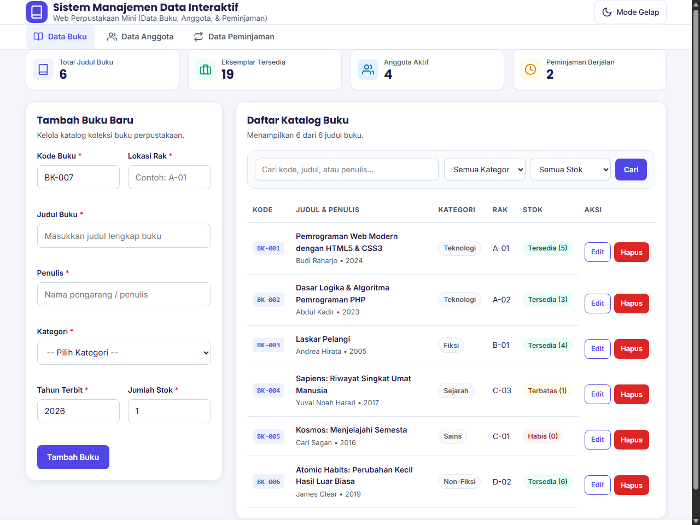
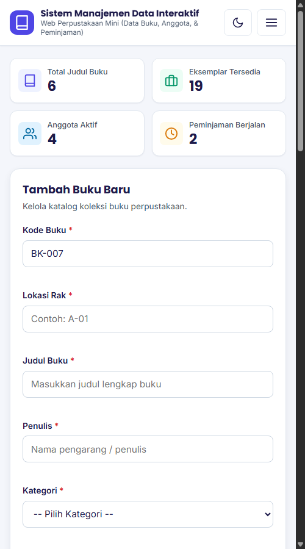

# Sistem Manajemen Data Interaktif — Web Perpustakaan Mini

Aplikasi web dinamis **Web Perpustakaan Mini (Data Buku, Anggota, & Peminjaman)** yang dibangun untuk memenuhi Ujian Tengah Semester (UTS) mata kuliah **Pemrograman Web**. Aplikasi ini mengintegrasikan materi Pertemuan 1 hingga Pertemuan 7 menggunakan **HTML5 Semantik**, **CSS3 Modern (Mobile-First, Flexbox, CSS Grid)** tanpa framework eksternal, **Vanilla JavaScript**, dan **PHP Native Prosedural**.

---

## Identitas Mahasiswa
- **Nama Lengkap:** M Fachri A.H
- **NIM:** 17241003
- **Kelas:** TI 5.A
- **Mata Kuliah:** Pemrograman Web
- **Repositori GitHub:** `https://github.com/Siiarii/web-perpus-mini`

---

## Fitur Utama

1. **HTML5 Semantik & CSS3 Modern Responsif**
   - Menggunakan elemen semantik secara konsisten: `<header>`, `<nav>`, `<main>`, `<section>`, `<article>`, dan `<footer>`.
   - Tata letak menggunakan **Flexbox** (header, navigasi modul, toolbar filter, tombol aksi) dan **CSS Grid** (4 kartu ringkasan statistik & layout 2 kolom form + tabel).
   - Pendekatan **Mobile-First Design** (`@media (min-width: 768px)` dan `@media (min-width: 1024px)`) sehingga tabel otomatis berubah menjadi kartu vertikal pada layar smartphone tanpa horizontal scroll.
   - Mendukung **Light Mode & Dark Mode** berbasis CSS Variables (`:root` dan `body.dark-mode`).

2. **Interaktivitas Client-Side (JavaScript & DOM)**
   - **Toggle Tema (Dark/Light Mode):** Menyimpan preferensi tema di `localStorage` (`saved-theme`).
   - **Validasi Form Real-Time:** Memeriksa seluruh kolom wajib pada modul Buku, Anggota, dan Peminjaman saat mengetik/memilih serta saat submit.
   - **Manipulasi DOM Interaktif:** Perhitungan otomatis tanggal jatuh tempo (+7 hari dari tanggal pinjam), pratinjau ringkasan transaksi peminjaman secara langsung, toggle menu navigasi mobile, serta dialog konfirmasi sebelum menghapus data atau mengembalikan buku.

3. **Pemrosesan Backend (PHP Native — GET & POST)**
   - **Modul Data Buku:** Tambah, edit, hapus, serta pencarian & filter berdasarkan kata kunci, kategori, dan status stok (`GET`).
   - **Modul Data Anggota:** Pendaftaran, edit, hapus, serta pencarian & filter status keanggotaan (`GET`).
   - **Modul Data Peminjaman:** Pencatatan peminjaman dan pengembalian buku dengan pembaruan stok buku otomatis, serta filter status peminjaman (`GET`).
   - **Keamanan & Penyimpanan:** Anti-XSS (`htmlspecialchars`), validasi `REQUEST_METHOD`, token CSRF berbasis `session_id()`, pola **PRG (Post-Redirect-Get)**, Flash Message, Sticky Form, dan penyimpanan persisten pada `data/perpustakaan.json` (dengan fallback `$_SESSION`).

---

## Struktur Folder

```text
web-perpus-mini/
├── index.php
├── proses.php
├── data/
│   └── perpustakaan.json
├── includes/
│   ├── helpers.php
│   ├── header.php
│   └── footer.php
├── assets/
│   ├── css/
│   │   └── style.css
│   └── js/
│       └── script.js
├── docs/
│   ├── screenshots/
│   │   ├── desktop.png
│   │   └── mobile.png
│   └── Laporan Project Faisal Listianto.docx
├── README.md
└── .gitignore
```

---

## Cara Menjalankan di Lokal (XAMPP)

1. Pastikan folder `web-perpus-mini` berada di dalam direktori `C:\xampp\htdocs\web-perpus-mini`.
2. Jalankan **Apache** melalui XAMPP Control Panel.
3. Buka browser dan akses:
   ```text
   http://localhost/web-perpus-mini/
   ```
4. Atau jalankan langsung dengan PHP built-in server dari terminal:
   ```bash
   php -S localhost:8000
   ```
   Lalu buka `http://localhost:8000`.

---

## Dokumentasi Visual

### Tampilan Desktop


### Tampilan Mobile

